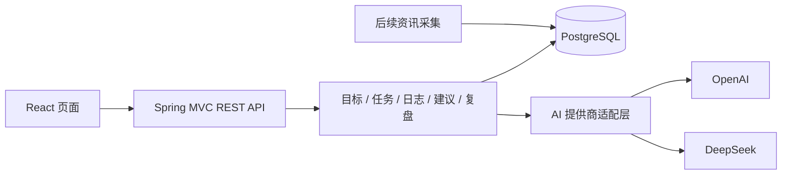

# AI Growth Hub 开发实施计划 V1.1

编制日期：2026-10-15
状态：后续实施基线；现已开始实施，M0/M1 完成情况见 docs/progress.md。
依据：用户提供的 AI_Growth_Hub.docx，以及分享聊天记录《职业发展分析》。
目标用户：已有 Java 后端和 AI 应用实践基础、希望持续提高 AI 工程交付能力的个人开发者。

## 1. 技术方案结论

原方案总体合理。React + Spring Boot + PostgreSQL 的模块化单体，既能利用已有 Java 能力，也能练习完整的 AI 应用交付。项目的价值来自持续使用、可靠数据和可验证成果。

保留：前后端分离、关系数据库、Flyway、容器部署、多模型提供商适配、AI 建议确认后落库。

调整：

1. 第一版只实现目标、任务、日志、每日 AI 建议及确认流程；周复盘与周计划随后加入。
2. 将学习路线和资讯聚合放在核心流程验证之后，避免为推荐功能先搭复杂基础设施。
3. JPA 与 MyBatis 选择 JPA，不同时维护两套数据访问框架。
4. AI 接入使用小型业务适配接口与 HTTP 客户端；第一版暂不引入 Agent 框架和自动工具执行。
5. 将幂等、并发确认、上下文版本、超时恢复、备份恢复纳入验收，不只验证页面能用。
6. 原文 Spring Boot 3.x 是候选旧基线。初始化时选择仍在官方支持期、与 Java 21 及必要依赖兼容的稳定系列，并锁定具体版本；不因为旧计划写了 3.x 就固定采用失去支持的版本。

## 2. 产品目标与衡量方式

每日维护控制在 3–5 分钟；可跳过、休息和调整安排。学习时间与开发时间分别记录，不能把同一段时间重复计算。

首轮成功标准：

- 使用者能够连续跨越 7 个自然日保存、查看和修改记录；不要求每天学习。
- 不手动操作数据库即可完成“保存日志 → 生成建议 → 编辑确认 → 得到次日任务”。
- AI 失败时，原始记录和任务管理仍可使用。
- 每项推荐包含可检验产出，并指向已有目标或注明未关联。
- 使用者每周至少能从记录中找到一项真实成果或明确的阻塞问题。

AI 对掌握程度的描述始终属于推断。证据字段引用真实记录，不能把任务完成或模型评价直接当成能力认证。

## 3. 版本范围

| 阶段 | 包含 | 明确延期 |
| --- | --- | --- |
| V0.1 核心闭环 | 手工长期目标、任务 CRUD、日志 CRUD、每日分析、建议编辑与确认、基础设置、JSON 数据导出 | 自动 12 周路线、周计划实体、自由聊天、资讯、复杂图表 |
| V0.2 可持续使用 | 周计划、周复盘、成果记录、7 天试用问题修复、备份恢复脚本 | 月复盘、知识图谱、推荐算法 |
| V0.3 资讯扩展 | 用户确认的 14 个平台创作者/栏目订阅（雪球、集思录、淘股吧、东方财富、同花顺、韭圈儿、有知有行、微信公众号、知乎、微博、小红书、掘金、CSDN、V2EX）；平台适配器、定时/手动拉取、去重、按需摘要、收藏、候选任务；逐平台验收公开源、登录态与反爬约束 | 界面任意 URL 抓取、绕过平台访问控制、无授权保存或复用账号 Cookie、全文检索 |
| V0.4 部署交付 | Linux 容器部署、单用户登录、HTTPS、恢复演练、运行手册 | 多用户、多租户、移动原生应用 |

安全约束：V0.4 完成之前，仅在本机或有访问控制的私网试用。若提前远程访问，登录、HTTPS、网络隔离和备份必须提前完成。

不纳入当前路线：微服务、Redis、消息队列、向量数据库、模型微调、Kubernetes、自主多 Agent。后续以真实问题决定是否增加。

## 4. 技术选型与版本规则

| 层次 | 计划选型 | 选择理由与边界 |
| --- | --- | --- |
| 前端 | React 19、TypeScript、Vite | SPA 已覆盖需求，无 SEO 或服务端渲染诉求 |
| 路由/请求 | React Router、TanStack Query | 管理页面、请求缓存、失效刷新与错误状态 |
| UI | Ant Design + 少量项目样式 | 优先表单、日期、任务列表和可访问性；初始化验证 React 兼容性 |
| 前端包管理 | npm + package-lock.json | 减少工具数量，使用 npm ci 保证安装一致 |
| 后端 | Java 21、Spring Boot、Spring MVC | 常规 REST 业务；不引入响应式链路 |
| 数据访问 | Spring Data JPA、Bean Validation、Flyway | 关系约束和事务优先；实体不直接作为接口响应 |
| 数据库 | PostgreSQL 17，初始化锁定安全补丁版本 | 足够覆盖关系数据、快照和 JSONB；遵循受支持版本更新策略 |
| AI | 自定义 AiProvider 接口 + Spring HTTP 客户端 | 先做 OpenAI、DeepSeek 两个适配器，不假定接口能力完全相同 |
| 构建/交付 | Maven Wrapper、Docker Compose | 单仓库、可重复构建、标准化 Linux 部署 |
| 测试 | JUnit、Testcontainers、Vitest、Playwright | 重点验证 PostgreSQL 事务和核心操作流程 |

Node.js 使用 24 LTS，启动时核验实际版本与 Vite 模板兼容性。Spring Boot 具体版本作为 M0 的交付物：先核验官方支持状态，再验证 JPA/Flyway/测试依赖，记录到 docs/architecture.md；本计划不虚构已安装环境。

查阅时 Spring 官方已提供 4.x，说明原文的“3.x”不宜直接照抄。M0 优先评估官方当前支持的稳定版本，只有明确依赖阻塞且候选版本仍受支持时才选其他系列。所有 Java 依赖优先跟随 Boot BOM，避免手工覆盖一组不匹配的版本。

## 5. 架构与模块



后端按业务组织包：goal、task、studylog、coach、review、settings、common；V0.2 加 plan、achievement，V0.3 加 feed。模块内按 controller/service/repository 分层，不先拆多个 Maven 服务。

Controller 负责输入输出，Service 负责规则与事务，Repository 负责查询。AI 网络调用不放在长数据库事务中。

部署时浏览器经同一域名访问静态页面和 /api，减少跨域配置。开发期通过 Vite 代理 /api；不开放任意来源 CORS。

## 6. 页面和主要流程

V0.1 五个页面：

- 今日：今日任务、快速记录入口、最近一次 AI 分析、待确认建议。
- 计划：长期目标与任务列表；按日期查看，支持延期和取消。
- 日志：按日期查询、原文编辑、实际时长、成果和阻塞点。
- 建议详情：来源记录、分析、候选任务编辑、确认/拒绝、已有确认结果。
- 设置：时区、常用每日可用时间、主题偏好、提供商与模型选择、导出入口。

V0.2 增加周计划/复盘/成果记录；AI 教练初期是结构化分析与建议页面，不承诺持续对话记忆。

每日流程：

1. 用户查看今日任务，完成学习后保存日志；保存不依赖 AI。
2. 用户主动触发分析，选择目标日期并填写该日可用分钟数；默认使用设置值。
3. 服务端冻结上下文快照，创建分析记录，返回处理状态。
4. AI 返回结果后，服务端做结构和业务校验，生成待确认建议。
5. 用户调整候选任务、日期和时长，再显式确认；服务端事务创建任务并记录映射。
6. 重复点击或网络重试返回同一批任务；用户也可拒绝建议并手动安排。

任务过期仅标记“逾期”，不自动改日期；用户选择延期或接受重新排期建议。缺席不扣分、不强制补课。

## 7. 领域数据设计

主键使用 UUID；事件时间使用 timestamptz，学习/排期日期使用 date。默认业务时区 Asia/Shanghai，可在设置修改；历史日期不随服务器时区变化。主要可编辑实体带 created_at、updated_at、version。

| 表 | 阶段 | 核心内容 |
| --- | --- | --- |
| learning_goal | V0.1 | 标题、描述、起止日期、优先级、状态 |
| learning_task | V0.1 | goal_id 可空、标题、描述、scheduled_date、estimate_minutes、priority、status、source、acceptance_criteria、completed_at |
| study_log | V0.1 | study_date、content、duration_minutes、achievements、blockers、version；同日可多条 |
| study_log_task | V0.1 | 日志和任务关联；联合唯一约束 |
| ai_analysis | V0.1 | 类型、请求幂等键、provider/model、prompt/schema 版本、上下文快照、结果、状态、耗时、token、错误码 |
| plan_suggestion | V0.1 | analysis_id、target_date、候选任务 JSONB、version、状态、confirmed_at |
| suggestion_task | V0.1 | suggestion_id、候选条目稳定 ID、task_id；唯一约束保证每条只创建一次 |
| app_setting | V0.1 | 时区、时间预算、偏好、默认提供商/模型；不存 API 密钥 |
| weekly_plan | V0.2 | week_start、主题、计划分钟数、状态；task 增加可空 weekly_plan_id |
| weekly_review | V0.2 | week_start 唯一、source_snapshot、ai_draft、final_content、确认时间 |
| achievement | V0.2 | 标题、说明、URL、类型、日期、关联目标/任务；V0.1 日志成果文本仍保留 |
| feed_source / feed_item | V0.3 | 来源配置、规范化 URL、外部 ID、发布日期、抓取时间、摘要、指纹、收藏状态 |

索引优先依据实际查询：任务日期/状态、日志日期、分析请求键、复盘 week_start；不为所有字段机械加索引。

任务状态：TODO、IN_PROGRESS、DONE、CANCELLED；延期是改日期，不额外引入歧义状态。目标归档后保留关联数据。删除已被历史引用的内容使用归档或软删除，避免破坏追溯。

建议状态：DRAFT、CONFIRMED、REJECTED、SUPERSEDED。分析状态：PENDING、RUNNING、SUCCEEDED、FAILED。确认后的建议只读；改动正式任务通过任务接口处理。

V0.1 不加入空置 owner_id。需要多用户时统一增加账户与归属迁移；单用户登录属于访问保护，不等于多租户设计。

## 8. 接口实施清单

统一使用 /api/v1。列表支持日期过滤与分页，错误结构包含 code、message、fieldErrors、requestId，禁止返回密钥或内部堆栈。

| 接口 | 作用/约束 |
| --- | --- |
| GET /dashboard?date= | 当日任务、最近日志、待确认建议、基础统计 |
| GET/POST /goals | 查询和创建目标 |
| PATCH /goals/{id} | 编辑/归档，带 version |
| GET/POST /tasks | 过滤查询、手动创建任务 |
| PATCH /tasks/{id} | 改状态、日期、内容，带 version |
| GET/POST /study-logs | 查询、保存原始记录 |
| GET/PATCH /study-logs/{id} | 详情、修改；保留分析快照中的旧版本 |
| POST /ai/analyses | 创建每日分析，Idempotency-Key；返回 202 与 analysis_id |
| GET /ai/analyses/{id} | 查询执行状态、结果和失败原因 |
| GET/PATCH /plan-suggestions/{id} | 查询、编辑待确认建议，带 version |
| POST /plan-suggestions/{id}/confirm | 确认指定版本；事务落库、幂等返回任务 ID |
| POST /plan-suggestions/{id}/reject | 拒绝草稿 |
| GET/PATCH /settings | 非敏感设置、提供商与模型选择 |
| GET /exports | 导出带 schema_version 的 JSON；完整恢复使用数据库备份 |
| GET/POST/PATCH /weekly-plans | V0.2 周计划；实际路径细分在 API 文档中固化 |
| POST /reviews/weekly/generate | V0.2 生成/重生成指定周草稿，引用快照 |
| GET/PATCH /reviews/weekly/{id} | V0.2 查询、编辑和确认 |
| GET/POST/PATCH /achievements | V0.2 成果管理 |

本地开发阶段无公开注册。服务器发布增加登录、退出、会话状态接口；基于 Spring Security 的单用户 Session Cookie，启用 CSRF 保护，生产 Cookie 使用 HttpOnly/Secure/SameSite；不自建 JWT 刷新体系。

## 9. AI 分析与可靠性

### 9.1 输入与输出

输入以目标、选定日志、近 7–14 天记录、未完成任务和目标日期预算为主。限制单条/总文本长度与总输入 token；裁剪须明确，不能悄悄删除当天原始记录。可先使用近期截取，不做向量检索。

统一输出：summary、learned_topics、evidence、open_questions、mastery_assessment、tomorrow_tasks、plan_adjustment_reason。

任务字段：item_id、title、reason、estimated_minutes、acceptance_criteria、goal_id、existing_task_id 可空。证据引用真实日志/任务 ID。

合法的建议可以是 0 项任务，例如休息日或用户无可用时间；有可用时间时通常 1–3 项。分钟数为正整数，总和不得超过选定预算。优先建议继续已有未完成任务，避免每天复制同一个任务。

提供商原生结构化输出作为增强能力，统一由服务端做 JSON/Schema 与业务校验。错误关联 ID、虚构证据、超时长、空验收标准均不能直接写入正式任务。

### 9.2 调用生命周期

- 先提交 PENDING 分析记录，再交给应用内有界执行器；轮询状态，第一版不做流式输出。
- 设置连接、读和总体超时；暂定总体上限 90 秒，最多一次有界重试，实际值在联调时调整。
- 单用户最多一个活动分析，限制排队与每日调用数；429 遵循 Retry-After 并受总超时约束，鉴权错误不重试。
- 同一请求键、同一输入返回已有分析；同一键用于不同输入返回冲突。
- 重启后将无法继续执行的 RUNNING 标记为可重试失败；PENDING 可由小型定时扫描领取，领取以数据库条件更新保证唯一。
- 不在数据库事务中等待模型响应；保存结果时检查分析状态，避免迟到响应覆盖取消或失败状态。
- 记录使用量与计价来源；拿不到 token 或价格时标为未知。每日次数/输出上限可硬限制，跨请求的金额只在有可靠用量时估算，不能承诺绝对精确费用封顶。
- 输入快照可能包含个人笔记；用户触发前提示会发送给选定提供商，日志仅写元数据与脱敏错误，不打印快照/密钥。

### 9.3 确认事务

锁定建议行并校验 DRAFT、version、预算、关联 ID、上下文新鲜度；为每项新任务创建记录并写入唯一 suggestion_task 映射，最后更新 CONFIRMED，在同一事务提交。

重复确认已确认建议返回原 task_id 列表。旧版本、已拒绝、已被替代的草稿返回 409。日志/目标在生成后改变时，提示来源已变化并要求重新生成，V0.1 不默默沿用旧建议。

新分析成功后，只有上下文相同且目标日期相同的旧未确认草稿被标记 SUPERSEDED；不同日志或不同日期的草稿不互相覆盖。确认时列出当天已有任务，预算计算包含待保留的已有任务；修改预算后再次校验。

涉及 existing_task_id 时明确显示“调整已有任务”，沿用原 ID；不得作为创建新任务处理。跨日期排期变化由确认动作一并执行并记录结果。

## 10. 质量与验收场景

测试随功能开发，不集中拖到最后一周。关键集成测试使用真实 PostgreSQL 容器，不用 H2 替代事务和 JSONB 行为。AI 测试以可控桩为主，另保留人工触发的小规模真实 API 验证。

| 场景 | 通过标准 |
| --- | --- |
| 首次空库 | 页面无异常，可先建目标和任务，再保存日志 |
| 手工流程 | AI 未配置时仍可完成任务、日志的新增修改和查询 |
| 正常 AI 流程 | 可查询状态、审阅来源、编辑草稿、确认次日任务 |
| 连点确认/并发请求 | 正式任务只生成一批，返回相同映射 |
| 部分写入失败 | 事务整体回滚，不出现只有部分任务成功 |
| 日志已修改/旧草稿 | 显示版本冲突，不覆盖新内容、不默默确认 |
| 提供商错误 | 覆盖 401、429、超时、畸形 JSON；原始日志完整 |
| 无时间/休息 | 可以生成零任务建议，无惩罚与强制补课 |
| 日期边界 | 上海时区跨日、周一起始、服务器 UTC 下结果一致 |
| 非法输出 | 超预算、错误目标 ID、虚构证据均被拒绝或需修正 |
| 备份恢复 | 新数据库恢复成功，任务/日志/建议关联及抽样原文一致 |
| 服务器访问 | 未登录不能读写业务数据；CSRF、登出、会话过期正确 |

前端覆盖草稿编辑和异步状态；Playwright 覆盖一条完整核心流程及 AI 失败后继续手工使用。覆盖率用于发现缺口，不为达到数字而写重复测试。

## 11. 里程碑、工时和交付

工时为单人有效投入估算，包含理解、调试与必要测试，不包含 API 等待、环境权限排障和长期使用观察。以下按顺序实施，以验收结果推进。

| 里程碑 | 估算 | 工作与交付 | 退出条件 |
| --- | --- | --- | --- |
| M0 环境与决策 | 4–6 小时 | 核对真实仓库路径、JDK/Node/Docker、版本组合；初始化前后端与数据库；README/架构决策 | 干净环境按文档启动、Flyway 建表、健康检查通过 |
| M1 手工学习流程 | 12–18 小时 | 目标/任务/日志、首页、关联、校验、错误处理、核心 API 测试 | 不依赖 AI 完成一次真实学习记录流程，重启后保留数据 |
| M2 AI 核心闭环 | 18–26 小时 | 两个提供商、分析生命周期、快照、校验、建议编辑与幂等确认 | 正常/超时/非法 JSON/重复确认场景通过 |
| M3 V0.1 试用 | 6–8 小时 + 7 个自然日观察 | 导出、最小数据库备份说明、提示与失败恢复、试用问题清单 | 跨越 7 天使用，可找回历史记录、无丢失/重复任务问题 |
| M4 周期成长 V0.2 | 12–18 小时 | 周计划、周复盘、成果记录、可重复备份恢复脚本 | 复盘引用真实日期/任务；恢复到空库校验通过 |
| M5 资讯 V0.3 | 12–20 小时 | 两来源、去重、按需摘要、收藏、转任务草稿 | 重复抓取不重复插入；采集失败不影响核心功能 |
| M6 部署 V0.4 | 10–16 小时 | 容器镜像、反代、登录、HTTPS、CI、部署与恢复演练 | Linux 部署与访问保护、备份恢复验收全部通过 |

V0.1：40–58 小时，另留 20% 机动，约 48–70 小时。若每周实际开发 5–8 小时，约 6–14 周；不是两周硬承诺。

完整路线：74–112 小时，另留 20% 机动，约 89–135 小时；每周 5–8 小时约 12–27 周。排期可依据真实熟练度与 AI 辅助效果缩短，不预支尚未验证的效率。

若两周内想先用：只交付 M0 + M1 的缩小版本（手工任务、日志），允许暂用手动 AI 对话；不能把它称为已经完成 M2 的完整 MVP。

每次实施只推进一个可验收切片：先给出实现范围，完成后说明如何运行、测试结果和待解决事项。每个里程碑保留简短“学到了什么、为何这样设计、如何证明有效”的工程记录。

## 12. 开发环境、部署与数据保护

当前已观察到：聊天曾使用 WSL 项目路径 /home/yi/projects/GrowthHub；切换后标注的 C:/home/yi/projects/GrowthHub 实际不存在。两者不能当作同一目录，也不应在不存在的 Windows 路径下自动新建一份同名项目。

M0 先确定唯一真实源码目录及执行环境。已有 WSL 仓库可继续使用，前提是当前工具能稳定访问；若选择迁移原生 Windows，应显式复制/克隆并校验 Git 状态。计划阶段不搬动文件，不重复安装环境。

开发期：前后端直接运行，PostgreSQL 使用 Docker；数据库端口仅绑定本机。生产期：反向代理、前端静态资源、后端、数据库组成 Compose 部署；数据库不映射公网端口，健康检查通过后接入流量。

统一配置项：数据库连接、APP_TIMEZONE、各提供商密钥/base URL/模型、AI 超时/预算/次数限制、生产认证配置。开发和生产采用相同配置名称、不同取值；localhost 与容器服务名不能混用。

密钥仅在服务端环境注入，.env 不进 Git，.env.example 只放占位符；浏览器设置页只显示配置是否存在。提供商 base URL 由管理员配置，浏览器不能任意修改，避免成为任意网络请求入口。

本地 V0.1 即提供手动数据库备份步骤；V0.2 起提供脚本；服务器每日备份、保留最近 7 日与最近 4 周副本，并验证至少一份独立存储位置。磁盘卷不是备份。恢复目标暂定 RPO 24 小时、RTO 2 小时，需演练后确认是否满足。

JSON 导出用于阅读与迁移辅助，不声称等价于完整数据库恢复。备份包含输入快照等个人数据，需限制访问；API 密钥单独管理，不写进数据导出。

## 13. 后续仓库目录

```text
GrowthHub/
  frontend/
  backend/
  infra/
    compose.dev.yml
    compose.prod.yml
  docs/
    development-plan.md
    architecture.md
    api.md
    ai-contract.md
    deployment.md
    progress.md
  scripts/
    backup/
    restore/
  .env.example
  README.md
```

CI 在 M0 建立编译/静态检查入口，随功能补充测试；M6 完成镜像与发布流程。数据库迁移已发布后不改旧文件，使用新的 Flyway migration 演进。

## 14. 风险、决策门槛与延期顺序

- 时间不足：依次延期资讯、趋势图、自动路线；优先保留数据完整、手工可用与确认安全。
- 推荐质量不足：先收集 5–10 条匿名化真实日志，用固定评估清单检查相关性、可执行性、证据与预算；不先增加 Agent 框架。
- 上下文越来越长：先做近期筛选与可追溯摘要，再评估全文检索/向量检索。
- 多提供商差异：适配器分别验证鉴权、请求/响应、结构化能力和使用量，不只换 base URL。
- 学习变成维护负担：试用时记录每日操作时长；超过 5 分钟优先简化表单和步骤。
- 新框架版本或工具不兼容：先调整最少的必要依赖，记录原因；不为使用最新版本重构整个应用。

进入 M0 时默认采用本计划；仓库路径、实际每周时间、可用 API 凭据在启动时核对。凭据不足可先使用桩完成业务开发，真实连通验证需后补，不假装通过。

本次用户已授权生成计划，尚未要求开始实施；文档中的安装、迁移、部署、调用 API 均为后续工作项。

## 15. 资料与版本核验来源

以下页面于 2026-10-15 查阅；实施时重新核验支持状态与补丁版本。

- [原始聊天记录：职业发展分析](https://chatgpt.com/share/6ad06a36-cbf0-83ee-85f4-99dda3bccefe)
- 本地来源文档：AI_Growth_Hub.docx；本计划保留其核心需求，补充实施边界。
- [Spring Boot 官方项目页](https://spring.io/projects/spring-boot/)
- [Spring Boot 系统要求](https://docs.spring.io/spring-boot/system-requirements.html)
- [React 官方版本说明](https://react.dev/versions)
- [Vite 官方入门与 Node 版本要求](https://vite.dev/guide/)
- [Node.js 官方发布与 LTS 状态](https://nodejs.org/en/about/previous-releases)
- [PostgreSQL 官方版本支持政策](https://www.postgresql.org/support/versioning/)


## 实施确认补充（2026-10-15）

用户确认项目名称 GrowthHub，唯一源码目录 /home/yi/projects/GrowthHub；授权在 WSL 安装开发工具并记录。数据库按 Ubuntu 官方软件源使用 PostgreSQL 18.6；本地原生服务，后续同版本容器部署。具体依赖以构建文件为准。计划中的原目录检查结论是当时 Windows 工具观察，现已确认真实 WSL 目录存在并为空后初始化。

### 资讯范围调整（2026-10-15）

用户明确确认：资讯需求是聚合关注的国内创作者/栏目，目标平台为雪球、集思录、淘股吧、东方财富、同花顺、韭圈儿、有知有行、微信公众号、知乎、微博、小红书、掘金、CSDN、V2EX。原先仅订阅 Spring Boot 与 pgvector 官方 Release 的实现不符合该需求，现按上述平台调整 V0.3 产品基线。平台公开接口、登录态要求、反爬限制及可持续性需分平台核验；不承诺绕过平台访问控制。
